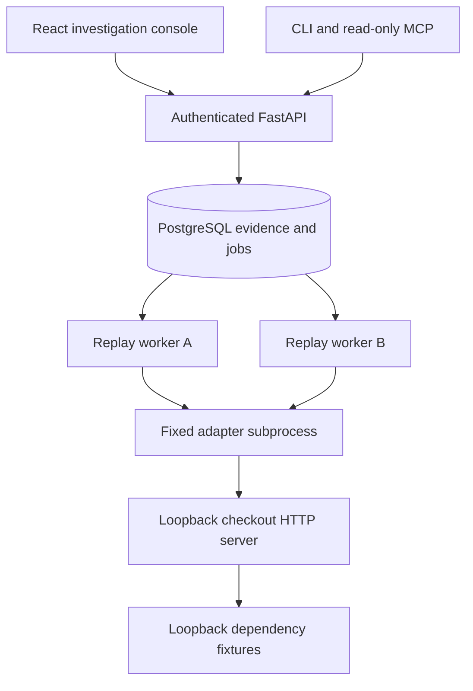

# Trace Atlas

[](https://github.com/Karthikvk1899/trace-atlas/actions/workflows/ci.yml)

**Follow an execution. Compare its evidence. Test a bounded reproduction.**

Trace Atlas is a self-hosted investigation workspace for distributed application executions. Import a parent-linked span graph, inspect the service path and waterfall, compare a successful execution with a failed one, and run a controlled HTTP experiment against the bundled checkout adapter.

The same tenant-scoped evidence is available through a React console, Python CLI, documented HTTP API, and read-only MCP tools. No model API or cloud subscription is required.

> **v0.1 is a working reference platform, not a universal replay engine.** Replay supports only `checkout-v1`, a supplied application that makes real loopback HTTP calls using captured inventory/payment status fixtures. It does not reconstruct arbitrary application code, replay production side effects, infer root cause, or ingest native OTLP. The timeline and comparison support any execution matching the normalized contract.

## Start locally

Prerequisites: Docker Engine with Compose v2, Python 3 for generating local credentials, approximately 4 GB available RAM, and free localhost ports 3000 and 8080. Application runtime is Python 3.12; frontend builds use Node 24 inside Docker.

```bash
git clone https://github.com/Karthikvk1899/trace-atlas.git
cd trace-atlas
python3 scripts/init_env.py
docker compose up -d --build --wait --scale worker=2
docker compose exec -T api python < scripts/seed.py
```

The last command creates a tenant, prints three randomly generated credentials, executes the bundled checkout application twice, and uploads the resulting evidence. Keep its output private. Open **http://localhost:3000**, enter the `investigator` credential, and:

1. Open **Checkout · payment unavailable**. Inspect the payment error and its parent checkout span.
2. Open **Compare**, select **Checkout · payment accepted**, and inspect the HTTP status differences.
3. Open **Replay setup**. With the captured payment response and expected status 502, the assertion should pass.
4. Override the payment response to 200 and expect checkout status 201. The new assertion should pass while **Matches capture** becomes **No**.
5. Export evidence, sign out, and connect with the `reader` credential. Investigation is available; replay mutation and ingestion are forbidden by the API.

A refresh signs you out. Credentials are held in browser memory, not localStorage. Re-running the seed creates another independent tenant. `docker compose down` preserves PostgreSQL data. `docker compose down -v` intentionally destroys the local demo database.

## Why this exists

A trace viewer can show a failure without providing a reproducible investigation. Trace Atlas connects evidence inspection to a deliberately constrained experiment, and makes the boundary between observed facts and replay assumptions visible.

| Layer | Implemented behavior |
| --- | --- |
| Console | Search/filter executions, parent-linked waterfall, service inventory and edges, span evidence, occurrence-aware comparison, export, replay controls/results, responsive layouts |
| Evidence | Versioned Pydantic contract, graph validation, 200-span/256 KiB limits, attribute allowlist, immutable tenant-scoped snapshots, content fingerprints |
| Replay | PostgreSQL queue, two competing workers, `SKIP LOCKED` claims, leased attempts, stale-worker fencing, idempotency conflicts, cancellation, explicit assertions |
| Isolation | Fixed adapter subprocess, no uploaded code or user-supplied destinations, sanitized environment, CPU/memory/file limits, wall-clock timeout, internal Compose network |
| Interfaces | FastAPI/OpenAPI, installable Python CLI, four read-only MCP tools, generated JSON Schema |
| Operations | Tenant-scoped Prometheus metrics, readiness checks, audit events, dependency interruption and logical restore rehearsal, pinned CI actions and dependency audits |

Kafka and Redis are intentionally absent. PostgreSQL is sufficient for the bounded durable job queue and evidence model in this release. There is no unsupported claim that adding infrastructure would improve correctness.



## CLI and MCP

For use outside the containers:

```bash
python3.12 -m venv .venv
. .venv/bin/activate
pip install --require-hashes -r requirements.lock
pip install --no-deps -e .
export ATLAS_URL=http://localhost:8080
# Set ATLAS_TOKEN privately to the appropriate credential.
atlas list
atlas ingest execution.json
atlas show EXECUTION_UUID
atlas compare BASELINE_UUID CANDIDATE_UUID
atlas replay EXECUTION_UUID --expect 201 --payment 200 --key unique-experiment-001
atlas job REPLAY_UUID
```

Retry the same replay request with the same key after a timeout. A changed request requires a new key. Authentication uses `ATLAS_TOKEN`, never a command-line token argument. The CLI disables environment proxy inheritance and does not follow redirects.

Configure an MCP client to execute the installed absolute path to `atlas` with argument `mcp`. Provide `ATLAS_URL` and a **reader** `ATLAS_TOKEN` through the client's secret/environment configuration. Tools: `list_executions`, `get_execution`, `compare_executions`, `get_replay`. The server uses the official MCP Python SDK over stdio. It neither requests model access nor offers replay mutation tools. Treat all evidence text returned to an assistant as untrusted data.

## Verification

```bash
pip install -e '.[test]'
ruff check atlas tests scripts
pytest -q
npm ci --prefix ui
npm test --prefix ui
npm run build --prefix ui
pip-audit -r requirements.lock
npm audit --prefix ui --audit-level=moderate

# Against the disposable quickstart stack:
docker compose --profile test run --rm --no-deps integration
python3 scripts/operations_test.py
```

CI runs the local checks, the real Compose stack with two workers, authenticated API/concurrency/lease tests, an MCP client round trip, Chromium investigation/replay/reader tests, API restart, PostgreSQL interruption, and restoration into an isolated disposable database. Browser screenshots and traces are retained as artifacts for seven days. See the workflow for exact checks and its run history for results; this README is not a substitute for a successful run.

## Contracts, operations, and boundaries

- [Architecture and consistency](docs/architecture.md)
- [HTTP, evidence and replay contracts](docs/contracts.md), [OpenAPI](docs/openapi.json), [execution JSON Schema](docs/execution.schema.json)
- [Operations and recovery](docs/operations.md)
- [Security policy and threat model](SECURITY.md)
- [Roadmap and non-goals](docs/roadmap.md)
- [Contributing](CONTRIBUTING.md)

No AWS deployment, public multi-tenant hosting, production capacity, high availability, live OIDC integration, external security assessment, or comprehensive container-image vulnerability assessment is claimed. Cross-host clock synchronization, partial-trace assembly, automatic retention, general-purpose replay adapters, and native OTLP ingestion are not implemented. Trace names and allowlisted attribute values still require producer-side privacy review.

MIT licensed. Built by Karthik Beesa.
